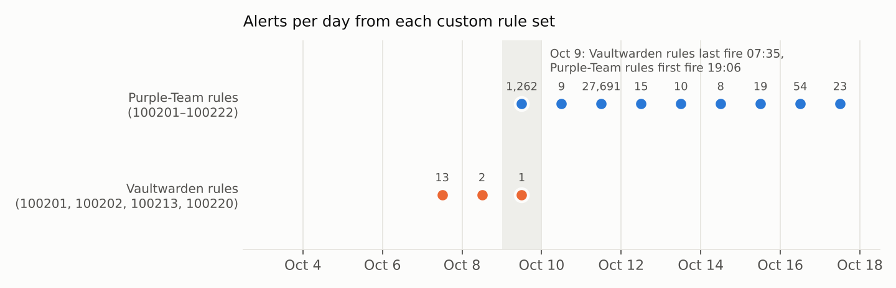

# 🔎 Homelab Threat Hunt: October 2026

A hypothesis-driven threat hunt across **15 days of Wazuh alerts, 14 days of Pi-hole DNS, 23 days of Suricata alerts and 2 days of pfSense firewall logs** from my segmented homelab. I asked ten questions an attacker would hope I never ask, answered each one from the data, and wrote down what I found, including the uncomfortable parts.

**Verdict: no evidence of compromise.** Every high-severity alert traced back to something I did, something Windows did, or a rule that needed tuning. But the hunt found **two high-severity detection gaps**. The worst one: my password-vault detections have had **nothing to read since Oct 11**, and before that, my own Purple-Team deployment had collided with them.

Every number below came from my own environment and is reproducible with the scripts in this repo. Addresses use the same fake `10.20.x.x` plan as my other repos (`192.0.2.x` for the upstream router network), and no credentials, real IPs, MACs or usernames are published.

## At a glance

| | |
|---|---|
| **Data** | 100,110 Wazuh alerts (Oct 3–18) · 504,369 DNS lookups (Oct 4–18) · 235,829 Suricata alerts (Sep 26–Oct 18) · 23,086 firewall blocks (Oct 16–18) |
| **Hosts** | 6 Wazuh agents (2× Ubuntu servers, Raspberry Pi, Windows 11 desktop, Windows 11 VM, Kali) + pfSense + 29 DNS clients across 6 zones |
| **Hunts** | 10 hypotheses · 2 high, 6 medium and 4 low findings · every lead closed |
| **Compromise found** | None |
| **Shipped** | 7 Wazuh tuning/detection rules, a Suricata suppress list, Pi-hole DoH and WPAD blocks, and a rule-ID linter with CI that catches the bug behind finding 1 |

## Findings

| # | Severity | Finding | Fix |
|---|---|---|---|
| 1 | 🔴 High | **Vault detections went blind, twice.** Oct 9: the Purple-Team rules reused three of the Vaultwarden rule IDs (`100201`, `100202`, `100220`). I caught that myself and renumbered the Vaultwarden rules to `1003xx` on Oct 15. Oct 11: Vaultwarden moved to a dedicated host that sends no logs to Wazuh, so none of its rules have had a single event to match since, whatever their IDs. | Give the vault a one-way log path to the SIEM; [`check_rule_ids.py`](scripts/check_rule_ids.py) now runs in CI |
| 2 | 🔴 High | **The IDS can't see the network it protects.** Suricata sits on the WAN behind NAT, so all 235,829 alerts name only the firewall's own address, and 99.47% are TCP stream-engine noise. In 23 days it raised exactly **one** ET threat signature, and even that took three other data sources to trace (it was my own git over SSH). | Suppress 4 stream SIDs; add a LAN-side Suricata instance |
| 3 | 🟠 Medium | **Sensors go dark without anyone noticing.** The Kali lab agent stopped on Oct 11 at 21:31 and never came back (7 days). `nexus-ai` was silent for 59 hours. Wazuh logs agent stops at **level 3**, the same as "USB device attached". | Level-10 rules for always-on hosts ([`100403`/`100404`](detections/wazuh/hunt_tuning_rules.xml)) |
| 4 | 🟠 Medium | **My isolated segment is only as isolated as Tailscale's ACL.** `igb2` is deliberately cut off from every other zone, and pfSense blocked every direct attempt in or out (155 in two days). But its host runs Tailscale, and so do 11 other addresses on my network, at least six of them separate machines, **including the Kali attack box**. Under Tailscale's default allow-all policy, every one of them can reach it through the tunnel, with no pfSense rule in the way. | Tag it in Tailscale and allow only my own devices to its one service port |
| 5 | 🟠 Medium | **Nine devices live outside the firewall.** On the upstream router's network, Windows PCs, a likely smart TV and smart plugs get no Pi-hole, no IDS and no segmentation. One of them briefly showed up on the **server LAN** with its upstream address. | Inventory them; move them behind pfSense or accept the risk in writing |
| 6 | 🟠 Medium | **The DNS server's firewall drifts.** The Pi-hole's CIS check "nftables default deny" passes on every reboot and fails by the next scan, 3 out of 3 times. The CIS score is 41%, and all 60 critical CVE alerts on it come from an HP printer stack a DNS server doesn't need. | Find what rewrites the ruleset; `apt purge` the printer packages |
| 7 | 🟠 Medium | **The AI server's kernel carries 1,014 CVEs.** Every high and critical vulnerability alert on `nexus-ai` is against the running kernel, `linux-image-7.0.0-38-generic`. It is already the newest kernel Ubuntu offers (checked Oct 18), so there is no stale package to remove and no update to apply yet. | Install kernel updates as soon as they ship and reboot into them; remove the unused older `7.0.0-34` kernel |
| 8 | 🟠 Medium | **Infrastructure hosts are used as web workstations.** 68.8% of the Pi-hole's own DNS is web browsing (Brave, AI chat, search). The SIEM server, the AI server and the Kali box browse too, ad trackers included. A browser exploit on the DNS server or the SIEM bypasses everything else. | Browse from the Trusted desktop; remove browsers and desktops from the servers |
| 9 | 🟡 Low | **DNS-over-HTTPS can bypass Pi-hole.** iCloud Private Relay and encrypted-DNS discovery are correctly blocked, but DoH endpoints like `cloudflare-dns.com` still resolve, and pfSense only blocks DoT (853). | [DoH denylist](detections/pihole) + pfBlockerNG DoH IP list |
| 10 | 🟡 Low | **WPAD lookups from the Windows desktop.** 1,296 `wpad.*` lookups (all NXDOMAIN today). Any device or tailnet node that takes the name `wpad` would be offered the desktop's web traffic as a proxy. | Turn off auto-detect proxy; sinkhole `wpad` in Pi-hole |
| 11 | 🟡 Low | **Vaultwarden logs the proxy, not the attacker.** Failed logins record `172.24.0.1` (the Docker gateway), so a brute-force rule could never block or attribute the source. | Set `IP_HEADER=X-Forwarded-For` so the real client IP is logged |
| 12 | 🟡 Low | **Alert fatigue, measured.** 5,083 level-12 "process injection" alerts, none of which requested injection rights. 23,272 "account enumeration" alerts, 85.4% from Wazuh itself. Only 1 of 109 "credential search" alerts was real. | 5 precise tuning rules (see [H6–H8](docs/hunt-log.md)) |



<sub>The Vaultwarden rules go quiet after Oct 9. The ID collision explains Oct 9–11; from Oct 11 the vault runs on a host whose logs Wazuh never receives.</sub>

## How the hunt worked

Each hunt starts with a hypothesis, an attacker behavior or a defensive assumption, and ends with a verdict backed by a query. The full write-up for each hunt, with the evidence tables, is in **[docs/hunt-log.md](docs/hunt-log.md)**.

| Hunt | Hypothesis | Verdict |
|---|---|---|
| H1 | Every custom detection I deployed is actually running | ❌ **False:** 3 rule IDs collided for six days, and the vault's logs never reach Wazuh (finding 1) |
| H2 | I would know if a sensor stopped reporting | ❌ **False:** stops alert at level 3 (finding 3) |
| H3 | Suricata would show me an infected internal host | ❌ **False:** WAN placement hides every host (finding 2) |
| H4 | Restricted zones can't reach Trusted or the servers | ✅ **True for pfSense.** But the isolated segment can still be reached over Tailscale (finding 4) |
| H5 | Every device in the house is behind the firewall | ❌ **False:** 9 are not (finding 5) |
| H6 | The 5,083 "process injection" alerts hide a real injection | ✅ **Rejected:** 0 of 5,083 requested write or thread rights |
| H7 | The credential-access alerts on Kali are an intruder | ✅ **Rejected:** but only **1 of 109** "credential search" alerts was a real credential search (my own Atomic test). The rest were cron jobs, Brave, system pipelines and my own shell |
| H8 | One of the 7,203 level ≥ 10 alerts is malicious | ✅ **Rejected:** all triaged to installers, updaters, Windows and my own tests. The one ET signature hit was git over SSH to GitHub |
| H9 | My hardening has held since I applied it | ❌ **False:** firewall drift and unneeded packages on the Pi-hole, 1,014 CVEs on `nexus-ai`'s kernel (findings 6–7) |
| H10 | Something is beaconing, tunneling or slipping past Pi-hole | ✅ **No beaconing, DGA or tunneling:** all 102 clockwork-regular lookups attributed, including one anonymous CDN host every 10 h (Brave's updater, 37 of 37 times). ⚠️ DoH, WPAD and browsing on servers need fixing (findings 8–10) |

A hunt that disproves an attacker hypothesis still counts. H6 and H7 turned 28,000+ scary-looking alerts into evidence-backed tuning instead of guesses, and H10 now gives me a baseline of what "normal" phoning home looks like on this network.

## What I'm changing

1. **Give the vault a one-way log path to Wazuh** (the same `/32 → /32` pattern as the Lab's Kali agent, or the agent over Tailscale with an ACL that allows only that port), then confirm the `1003xx` rules fire with a deliberate wrong password. `scripts/check_rule_ids.py` runs in CI against every rule file, and I'll run it against the manager's rules directory before each deploy.
2. **Deploy [`hunt_tuning_rules.xml`](detections/wazuh/hunt_tuning_rules.xml)** as `zz_hunt_tuning_rules.xml`, so it loads after the rules it tunes (Wazuh reads rule files alphabetically). It uses IDs `100400`–`100406`:
   - an access-mask rule that replaces my per-app "injection" allowlists, so any binary that asks for write or thread rights still alerts at level 12
   - a Tailscale exception for the discovery-burst rule
   - exact-binary exceptions for the account-enumeration and `/etc/shadow` rules
   - a credential-search rule that only keeps `find`/`grep` runs whose arguments look like a credential hunt
   - level-10 alerts when an always-on sensor stops
3. **Suricata:** add [the suppress list](detections/suricata/wan-suppress.txt), then run a second instance on the LAN trunk so alerts name real hosts.
4. **Network:** lock the isolated host down in the Tailscale ACL, identify the nine upstream devices, and update [Desk-Pi-Rack](https://github.com/KevinTechLabs/Desk-Pi-Rack) so the docs match reality.
5. **DNS:** add the [Pi-hole DoH denylist and WPAD sinkhole](detections/pihole), and stop browsing the web from the servers.
6. **Hardening:** find what rewrites the Pi-hole's nftables policy, purge the printer stack, remove the unused older kernel on `nexus-ai`, and reboot into kernel updates as soon as they ship.

## Lessons

- **Detection-as-code needs a linter, not just a repo.** Two rule files that were each fine on their own broke each other on deployment, and nothing complained. A ten-line ID check would have caught it before it shipped.
- **Tune on the mechanism, not the application.** "OneDrive is allowed" ages badly. "Nothing without write or thread rights counts as injection" covers OneDrive, Etcher, Discord and the next app, and still catches the real thing.
- **Look at who triggers a rule before you trust its count.** My busiest detection was mostly my SIEM watching itself, and my credential-search rule was right once in 109 alerts. A rule that passes its Atomic test can still be useless in production.
- **Where the sensor sits decides what it can say.** An IDS behind NAT can tell you something happened but never who did it. The one real signature hit in this hunt took three data sources and GitHub's IP list to explain: it was my own `git push`.
- **Absence of alerts is not absence of a sensor.** Silence has to be monitored like any other signal.
- **Know your own beacons.** Two thirds of my SIEM server's DNS is my GitOps agent polling every 60 seconds. Once the known heartbeats are written down, a new one stands out immediately.

## Reproduce it

```bash
pip install pandas matplotlib
cp scripts/site.example.json scripts/site.local.json   # your real addressing and names; gitignored, never published
python scripts/parse.py   <exports-dir> <parsed-dir>   # Wazuh alerts.json*, pfSense filter.log*, Suricata alerts.log, Pi-hole CSV
python scripts/hunts.py   <parsed-dir> evidence         # every hunt query; writes sanitized CSVs + headline.json
python scripts/charts.py  <parsed-dir> docs/images
python scripts/check_rule_ids.py detections/wazuh/*.xml
```

How the exports were collected is in [docs/collection.md](docs/collection.md). Raw logs are never committed (`.gitignore`); only the sanitized aggregates in [`evidence/`](evidence) are.

## Repository layout

```
README.md                 this report
docs/hunt-log.md          each hunt: hypothesis, query, evidence, verdict
docs/collection.md        how the logs were exported
docs/images/              charts
evidence/                 sanitized evidence tables produced by hunts.py
detections/wazuh/         new tuning and detection rules (IDs 100400-100406)
detections/suricata/      WAN suppress list
detections/pihole/        DoH denylist and WPAD sinkhole
scripts/                  parse.py, hunts.py, charts.py, check_rule_ids.py
tests/                    linter tests, including the exact collision found here
```

Related: [Homelab SIEM & Detection Lab](https://github.com/KevinTechLabs/Homelab-SIEM-Detection-Lab) · [Purple-Team Detection Lab](https://github.com/KevinTechLabs/Purple-Team-Detection-Lab) · [Sentinel SOC dashboard](https://github.com/KevinTechLabs/Homelab-Soc-Dashboard) · [Desk-Pi-Rack](https://github.com/KevinTechLabs/Desk-Pi-Rack)

