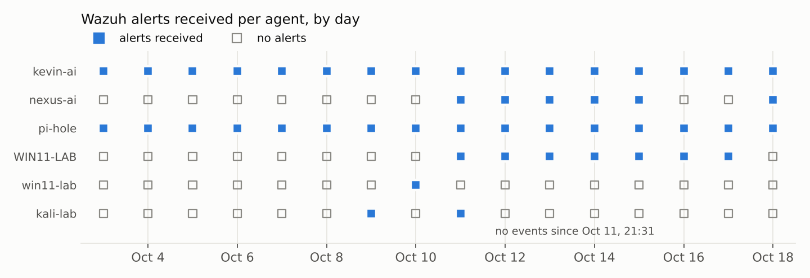
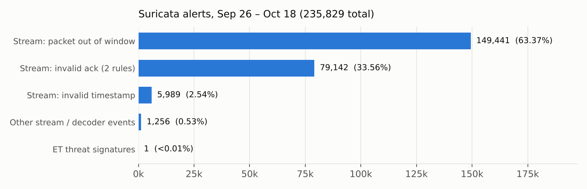

# Hunt log

Each of the ten hunts below lists the hypothesis, the data and query used, what the evidence showed, and the verdict. Section names (H1–H9) match the blocks in [`scripts/hunts.py`](../scripts/hunts.py), and every table links to its sanitized CSV in [`evidence/`](../evidence).

All times are US Pacific. Addresses use the repo's example plan:

| Example | Zone |
|---|---|
| `10.20.1.0/24` | Servers (main LAN) |
| `10.20.10.0/24` | Trusted |
| `10.20.30.0/24` | Gaming & IoT |
| `10.20.40.0/24` | Lab |
| `10.20.50.0/24` | Guest |
| `10.20.60.0/24` | an isolated segment on `igb2` |
| `192.0.2.0/24` | the upstream (ISP) router's network, where pfSense's WAN lives |

## Data in scope

| Source | Window | Volume | Notes |
|---|---|---|---|
| Wazuh alerts (`alerts.json` + daily archives) | Oct 3 17:02 – Oct 18 15:52 | 100,110 alerts, 6 agents | 7,203 at level ≥ 10 |
| Suricata fast log (pfSense WAN) | Sep 26 22:39 – Oct 18 14:34 | 235,829 alerts | EVE JSON was not enabled, so there's no flow or DNS metadata |
| pfSense `filter.log` | Oct 16 15:12 – Oct 18 15:58 | 23,086 blocks | Size-based rotation keeps only about 2 days |
| Pi-hole query log | Oct 4 15:50 – Oct 18 15:49 | 504,369 lookups, 29 clients | Domain, client, type and Pi-hole status; no answer IPs |

| Agent | Role |
|---|---|
| `kevin-ai` | Home lab server: Wazuh manager, Sentinel, CI/CD (and Vaultwarden until Oct 11) |
| `nexus-ai` | AI server |
| `pi-hole` | Raspberry Pi DNS |
| `WIN11-LAB` | Windows 11 desktop (Trusted) |
| `win11-lab` | Windows 11 VM used for Windows Purple-Team runs |
| `kali-lab` | Kali box (Lab VLAN) |

---

## H1. Is every custom detection I deployed actually running?

**Why:** Custom rules live in several repos and get copied to the manager by hand. If two rules share an ID, nothing fails loudly: Wazuh at most logs a warning in `ossec.log`, and one of the two stops doing its job.

**Query:** For every custom rule ID (100100–100399), list the distinct descriptions it has alerted with and when.

**Evidence** ([h1_rule_id_collisions.csv](../evidence/h1_rule_id_collisions.csv)):

| Rule ID | Description seen | First | Last | Alerts |
|---|---|---|---|---|
| 100202 | Vaultwarden: password brute force | Oct 7 20:24 | Oct 7 20:24 | 1 |
| 100202 | T1087.001: Local account enumeration | Oct 9 19:06 | Oct 11 21:31 | 23,272 |
| 100220 | Vaultwarden: deployment file changed | Oct 7 20:27 | Oct 7 20:28 | 4 |
| 100220 | T1070.001: Windows Security event log was cleared | Oct 10 11:42 | Oct 10 11:42 | 1 |

`100201` collides too: it's "Vaultwarden: failed login" on the server and "T1070.003: Bash history tampering" in the Purple-Team file. The Purple-Team version never fired in the window, so it doesn't show up above.

**Timeline**, from the alerts and the sudo log on `kevin-ai`:

| When | What happened |
|---|---|
| Oct 7–9 | Vaultwarden runs on `kevin-ai`; its rules fire normally. The last one is Oct 9 at 07:35 |
| Oct 9, 19:06 | The Purple-Team rules start firing. Three of their IDs are already used by `vaultwarden_rules.xml`; both files are loaded, and nothing complains |
| Oct 11, ~19:20 | I archive the Vaultwarden data and move the vault to a dedicated, isolated host |
| Oct 15, 20:21 | I spot the collision myself, back up `vaultwarden_rules.xml` and renumber it from `1002xx` to `1003xx` |
| Since Oct 11 | No Vaultwarden rule fires, because the vault's logs no longer reach Wazuh at all |

So the collision was real but short-lived, and already fixed by hand. The bigger, still-open gap is that the vault moved somewhere the SIEM can't see. Its brute-force, failed-login and file-change rules are correct and loaded, but they have nothing to read.

**Verdict:** ❌ Hypothesis false. **High** severity: since Oct 11 the password vault has had no failed-login, brute-force or tampering detection.

**To confirm on the manager:**
```bash
python scripts/check_rule_ids.py <(docker exec single-node-wazuh.manager-1 sh -c 'cat /var/ossec/etc/rules/*.xml')   # expect: 0 problems
```

**Fix:** Ship the vault's logs to Wazuh over one narrow, one-way path, then trigger a wrong-password login to prove the `1003xx` rules fire. [`scripts/check_rule_ids.py`](../scripts/check_rule_ids.py) now runs in CI, and [`tests/`](../tests) reproduces the Oct 9 collision so it can't come back.

---

## H2. Would I know if a sensor stopped reporting?

**Why:** Stopping the security agent is one of the first things an intruder does (T1562.001, *Impair Defenses*).

**Query:** Agent lifecycle alerts (rules 501–506) per agent, plus the last alert seen from each agent ([h2_agent_lifecycle.csv](../evidence/h2_agent_lifecycle.csv)).



**Evidence:**
- **`kali-lab`:** stopped cleanly at **Oct 11 21:31:45** and never started again, so the Lab VLAN has had no host telemetry for 7 days.
- **`nexus-ai`:** the agent stops and starts most evenings (for example, started 20:54 and stopped 22:15 on Oct 11). The longest gap is Oct 15 23:26 → Oct 18 10:16, about **59 hours**.
- **Every lifecycle alert is level 3,** the same level as "USB device attached". A deliberate `systemctl stop wazuh-agent` by an intruder would look identical to my own shutdowns.

A grey square in the chart means *no alerts that day*, not proof the agent was down. The stop and start events above are what confirm the gaps.

**Verdict:** ❌ Hypothesis false. **Medium** severity.

**Fix:** Rules [`100403` and `100404`](../detections/wazuh/hunt_tuning_rules.xml) raise agent stop and disconnect to level 10 on the always-on hosts (`kevin-ai`, `pi-hole`). Machines I power off on purpose are left out, so they don't page every night. Sentinel's watched-device check should include `kali-lab` whenever it's meant to be on.

---

## H3. Would Suricata show me an infected internal host?

**Why:** An IDS is only useful if an alert leads to a machine.

**Query:** Signature breakdown, and every internal address that appears in any alert ([h3_suricata_signatures.csv](../evidence/h3_suricata_signatures.csv)).



**Evidence:**
- Suricata runs on the **WAN** interface. The WAN sits behind both pfSense's NAT and the upstream router (double NAT), so the **only internal address in all 235,829 alerts is the firewall's own WAN address** (`192.0.2.57`). Every internal host is invisible behind it.
- **99.47%** of alerts are four TCP stream-engine events (out-of-window packets, invalid ACKs, invalid timestamps) on long CDN downloads. Downloads from two Akamai CDN addresses produced **217,892 alerts in a single hour** on Oct 17.
- **One** ET threat signature in 23 days: `ET SCAN Potential SSH Scan OUTBOUND` on Oct 4 at 22:56 (lead U1 in H8). Because of NAT, Suricata couldn't tie it to a machine; it turned out to be git over SSH to GitHub.
- The "invalid checksum" alerts all fall on **Sep 26** and never recur, which fits hardware checksum offload being disabled that day, the fix Desk-Pi-Rack documents.
- Inbound internet scanning barely reaches this sensor, because the upstream router drops it first. In two days, only 587 WAN packets from public addresses were blocked, and they were mostly stale replies from Google, Meta and Cloudflare, not scans. That explains why there's so little signature activity.

**Verdict:** ❌ Hypothesis false. **High** severity: the IDS can tell me *that* something happened, never *who*.

**Fix:**
1. Add [`wan-suppress.txt`](../detections/suricata/wan-suppress.txt) to remove the 4 stream SIDs.
2. Run a second Suricata instance on the LAN trunk (`igb0`), so alerts carry internal addresses.
3. Enable EVE JSON with flow and DNS records and ship it to Wazuh, so alerts can be joined to firewall states.

---

## H4. Can restricted zones reach Trusted or the servers?

**Why:** Segmentation is the main promise of the network design ([zones.md](https://github.com/KevinTechLabs/Desk-Pi-Rack/blob/main/network/zones.md)).

**Query:** Every internal-interface block, classified as stale TCP state (FIN/RST/ACK with no state) or an explicit block rule, and every attempt towards a private address ([h4_internal_blocks.csv](../evidence/h4_internal_blocks.csv)).

**Evidence (Oct 16–18):**
- **741 internal blocks.** 447 are stale TCP packets hitting the default deny after their state expired, which is normal on any stateful firewall. Their bursts are irregular, so I tested and **rejected** the idea that pfBlockerNG's "kill states on update" (every 4 h) was cutting connections.
- **Gaming & IoT made zero attempts to reach another zone.** Its only private-address packet was a roaming device renewing an old DHCP lease.
- **The isolated segment (`igb2`):** this one is cut off from every other zone on purpose, and the logs show pfSense enforcing it. Every blocked packet from its host was Tailscale trying to find its peers:
  - NAT-PMP and UPnP port-mapping probes to its gateway (112)
  - WireGuard direct-connection attempts on UDP 41641 to two Trusted devices (61)

  Those devices tried back on 41641 (94) and hit a block rule on TRUSTED. Nothing crossed in either direction.

**The catch.** Tailscale exists to connect peers a firewall separates: when direct WireGuard fails, it relays through its DERP servers over the internet. DNS shows 11 other addresses talking to Tailscale's control plane. Some are the same desktop on new DHCP leases, but at least six are separate machines: all three servers, the Trusted desktop and phone, and the **Kali attack box**. Under Tailscale's default policy every node can reach every other node, so for the isolated host **the real access policy is the tailnet ACL, not pfSense**.

**Verdict:** ✅ True for pfSense. **Medium** finding for the Tailscale path around the isolated segment.

**Fix:** In the tailnet policy, tag the host (for example `tag:isolated`) and replace allow-all with explicit grants: only my own phone and desktop may reach its one service port, and nothing may reach SSH except one admin device. Then confirm from the Kali box that `tailscale ping` still works but the service port doesn't answer. Documenting `igb2` and rule 125 in Desk-Pi-Rack, in general terms, keeps the docs honest without describing what's on it.

---

## H5. Is every device in the house behind the firewall?

**Query:** Sources on the WAN interface that belong to the upstream router's own network ([h5_upstream_hosts.csv](../evidence/h5_upstream_hosts.csv)).

**Evidence:** Besides the upstream router itself, nine devices live on its network, *outside* pfSense. Their broadcasts identify the types:

| Device type (from broadcast ports) | Count |
|---|---|
| Windows PCs (NetBIOS 137, LLMNR 5355, WS-Discovery 3702) | 3–4 |
| Likely smart TV (port 8001) | 1 |
| TP-Link smart-device discovery (9999) | 1 |
| Generic mDNS/SSDP devices | 4–5 |

None of them get Pi-hole filtering, IDS coverage or VLAN isolation.

One of them, `192.0.2.165`, appeared **on the Servers LAN** on Oct 17 at 18:05 for 16 seconds, still using its upstream address. It was tearing down old HTTPS connections (FIN/RST) to the same cloud endpoints the Tailscale nodes use. pfSense dropped it with a built-in rule consistent with its anti-spoofing check ([h5_upstream_address_on_server_lan.csv](../evidence/h5_upstream_address_on_server_lan.csv)). That's what a laptop looks like when it's plugged into a server-LAN port after being on the upstream Wi-Fi. Harmless here, but it means a server-LAN switch port accepts unknown devices.

**Verdict:** ❌ Hypothesis false. **Medium** severity.

**Fix:** Inventory the nine devices from the upstream router's client list. Move household devices behind pfSense (IoT or Guest), or write down the accepted risk. Disable unused server-LAN switch ports on the TL-SG108E.

---

## H6. Do the "process injection" alerts hide a real injection?

**Why:** Wazuh rule 92910 (Sysmon event 10 against `explorer.exe`) fired **5,083 times at level 12** in 7 days. That is the volume where a real hit gets ignored.

**Query:** Decode each alert's `GrantedAccess` mask and check whether it includes any right that injection needs: `PROCESS_CREATE_THREAD` (0x2), `PROCESS_VM_OPERATION` (0x8) or `PROCESS_VM_WRITE` (0x20) ([h6_process_access_masks.csv](../evidence/h6_process_access_masks.csv)).

| Source | Mask | Injection rights? | Alerts |
|---|---|---|---|
| OneDriveSetup.exe | 0x40 | no | 2,926 |
| balenaEtcher.exe | 0x40 | no | 1,206 |
| OneDrive.exe | 0x40 / 0x101411 / 0x1040 | no | 716 |
| Discord.exe | 0x40 | no | 92 |
| MSI.TerminalServer.exe | 0x1410 | no | 54 |
| TranslucentTB.exe | 0x1410 | no | 32 |
| FileSyncConfig.exe | 0x40 | no | 30 |
| Raspberry Pi Imager installer | 0x40 | no | 27 |

**Verdict:** ✅ Rejected. **0 of 5,083** requested write or thread rights. My existing tuning (100100 Spotify, 100103 OneDrive) allow-lists by application, and it still missed OneDriveSetup, Etcher and Discord.

**Fix:** Rule [`100400`](../detections/wazuh/hunt_tuning_rules.xml) demotes on the **mask** instead of the app. Any binary, including one I've never heard of, that opens Explorer with write or thread rights still alerts at level 12.

---

## H7. Are the credential-access alerts on Kali an intruder?

**Query:** For the Purple-Team audit rules, decode who triggered them, using the `exe` and `auid` fields and the `execve` arguments ([h7_audit_rule_triggers.csv](../evidence/h7_audit_rule_triggers.csv)).

| Rule | Alerts | What actually triggered it |
|---|---|---|
| 100202 account enumeration | 23,272 | **85.4% the Wazuh agent itself** (FIM `syscheckd` and `modulesd` reading `/etc/passwd`). Plus `polkitd` 7.4% and `sudo` 3.6% |
| 100204 credential search (find/grep) | 109 | **1** real credential search (`find / -path */.aws/credentials`, my Atomic test, Oct 9 19:12). The rest were the `phpsessionclean` cron job (26), Brave's desktop-entry lookup (25), short non-interactive pipelines (`grep`, `grep ^tcp`, `grep ^udp`: 46) and my own shell while debugging NexusLab on Oct 11 (3, starting with a `grep -v lo` at 21:08:29) |
| 100203 /etc/shadow access | 68 | 45 `unix_chkpwd` (how PAM checks every sudo password), 11 Wazuh agent, the rest system services and test account creation |
| 100205 process discovery | 2,801 | `ps` from non-interactive sessions (99.9%) |

**Verdict:** ✅ Rejected: no intruder. But these rules pass their Atomic tests and are close to useless in production. The credential-search rule had a precision of **1 in 109**.

**Fix:** Rules [`100402`, `100405` and `100406`](../detections/wazuh/hunt_tuning_rules.xml) use exact binary paths and argument patterns, not "ignore root" or "ignore non-interactive". A web shell running as a service account has no login session either, and it must still alert.

---

## H8. Is any of the 7,203 level ≥ 10 alerts malicious?

**Query:** Group every level ≥ 10 alert by rule, agent and description, then triage each group from its event fields ([h8_high_severity_top50.csv](../evidence/h8_high_severity_top50.csv)).

| Rule (level) | Alerts | What it was | Verdict |
|---|---|---|---|
| 92910 (12) "process injection" | 5,083 | see H6 | Benign, tuned |
| 80710 (10) promiscuous mode | 446 | Docker veth interfaces on container start (322), `arp-scan` on `enp1s0` (110), libvirt VM interfaces (10). Rule `100105` for veth was already added on Oct 15 | Benign |
| 92151 (12) unmanaged PowerShell | 119 | .NET native-image generator `mscorsvw.exe` after a .NET update (109), MSI Center (10) | Benign |
| 100204 / 100203 | 177 | see H7 | Benign, tuned |
| 92213 (15) executable dropped in malware folder | 102 | balenaEtcher unpacking its bundled helper into `%TEMP%\pkg` (62); Brave, Edge and Spotify component updaters; winget installing rclone; the VM's PowerShell `Add-Type` compiling C# via `csc.exe` during my Windows Purple-Team session | Benign |
| 100222 (10) discovery burst | 44 | 41 were `tailscaled.exe` running `ipconfig /flushdns` and `/registerdns` | Benign, tuned (`100401`) |
| 92043 (10) netsh firewall rule added | 29 | MSI Center (23) and Tailscale (6) creating their own allow rules | Benign |
| 92058 (12) AppCompat database | 28 | Windows' scheduled `sdbinst -m -bg` (21), and an installer removing a shim (7) | Benign |
| 61618 (12) suspicious svchost | 20 | Normal `svchost -k … -s <service>` hosts. The parent-process field is empty in these events, which is likely what trips the rule | Benign (rule quality issue) |
| 100211 (10) systemd unit changed | 19 | snapd mounting new snaps on `kevin-ai` (14), lab tests (5) | Benign |
| 92206 (12) "PrintNightmare" DLL drop | 10 | Print Spooler staging Microsoft's inbox drivers (XPS Document Writer, PostScript, Unidrv) on Oct 15 at 20:19, during a burst of installer activity | Benign. To be thorough, check signatures with `Get-AuthenticodeSignature C:\Windows\System32\spool\drivers\x64\3\*.dll` |
| 100220 (12) | 5 | 4 Vaultwarden Caddyfile/compose edits on Oct 7, in the same session as my own Vaultwarden sign-in, 1 Security-log clear on the VM during my Purple-Team run (expected, and the detection worked) | Benign |
| 92041 (10) Base64-like registry value | 10 | No value captured in the alert fields | Low, not resolvable from this data |
| 80711 (10) process ended abnormally | 2 | `systemd-sslh-generator` crashing (SIGABRT) at boot on Kali | Benign |

Auth activity, at any level:
- **Vaultwarden:** 5 failed logins for my account at 20:24 on Oct 7, then a successful sign-in at 20:29 over Tailscale. That was me mistyping. It does expose finding 11: the failures were logged from `172.24.0.1`, the Docker gateway, not the real client.
- **Windows:** 7 failed logons, all at the local console: the setup broker (5) and two wrong Windows Hello PINs (status `0xC0000380`).
- **SSH:** one successful login, from a Tailscale address.

**Lead U1 (closed: my own git over SSH).** On Oct 4 at 22:56:19, Suricata raised `ET SCAN Potential SSH Scan OUTBOUND`: 5+ SSH connections in 2 minutes to `172.182.252.133:22`, a cloud-hosted address that also served HTTPS to this network on Oct 12, 15 and 17.

NAT hides which machine made the connections (H3). One minute later, `kevin-ai` had an interactive sudo session in the Sentinel repo, which is consistent with git or dev tooling, but the alert data alone couldn't prove it. The DNS hunt couldn't either (H10). What closed it was GitHub's own published IP list: `172.182.252.133` and `.136` are both listed under GitHub's `git` and `web` ranges. The "scan" was several quick SSH git operations (fetch, push) in a row, a well-known false positive for this rule.

**Verdict:** ✅ Rejected. No malicious activity found, and every lead is closed.

---

## H9. Has my hardening held since I applied it?

**Query:** CIS (SCA) check changes and vulnerability alerts per package ([h9_sca_changes.csv](../evidence/h9_sca_changes.csv), [h9_vulnerable_packages.csv](../evidence/h9_vulnerable_packages.csv)).

**Evidence:**
- **Pi-hole firewall drift.** The check *"Ensure nftables default deny firewall policy"* **passed** on the scan right after each agent start (Oct 11 20:02, Oct 16 17:46, Oct 17 18:07) and **failed** on the next scheduled scan (Oct 12 08:00, Oct 17 04:32, Oct 18 07:30). That's 3 out of 3 cycles. Something on the Pi replaces the default-deny ruleset hours after boot; Docker, Tailscale, or a ufw/nftables reload are the usual suspects.
- **Pi-hole CIS score: 41%.** All 60 *critical* vulnerability alerts on the Pi come from an HP printer stack: `hplip`, `printer-driver-hpcups` and four related packages. A DNS server has no use for them.
- **`nexus-ai`: 1,014 distinct high and critical CVEs, all on one package,** `linux-image-7.0.0-38-generic`. That is the running kernel, and on Oct 18 it was also the newest one Ubuntu offered (`apt list --upgradable` showed no `linux-` updates). So this is not a stale kernel left behind: these are CVEs Ubuntu hadn't shipped fixes for yet, or that the scanner matches on version alone. An older kernel, `7.0.0-34`, is still installed but unused.
- `kevin-ai` CIS score: 60%.

**Verdict:** ❌ Hypothesis false. **Medium** severity.

**Fix:**
```bash
# Pi-hole: find what changes the ruleset, then remove the printer stack
sudo nft list ruleset | grep -E "policy|chain"        # right after boot, and again a few hours later
sudo apt purge hplip hplip-data printer-driver-hpcups printer-driver-postscript-hp libsane-hpaio libhpmud0
# nexus-ai: remove the unused older kernel (never the one uname -r shows), then take updates as they ship
uname -r                                                    # 7.0.0-38-generic: keep this one
sudo apt purge $(dpkg-query -W -f='${Package}\n' 'linux-*7.0.0-34*') && sudo apt autoremove --purge
sudo apt update && sudo apt full-upgrade                    # reboot if it installs a new kernel
```

---

## H10. Is anything beaconing, tunneling or slipping past Pi-hole?

**Why:** Malware has to phone home, and DNS is where it usually shows first: regular check-ins, machine-generated (DGA) names, data stuffed into long subdomains, or encrypted DNS that skips the filter entirely.

**Data:** 504,369 Pi-hole lookups, Oct 4 15:50 → Oct 18 15:49, from 29 clients in every zone.

> **Privacy rule for this section:** phones and laptops in Trusted and Guest are analysed like everything else, but their app and browsing mix is only published as counts. Every table below lists infrastructure, IoT and lab hosts by name.

### Forced DNS reaches every zone ✅

Pi-hole saw clients from Servers (3), Trusted (10), Gaming & IoT (10), Lab (1), Guest (2) and the isolated segment ([h10_dns_zones.csv](../evidence/h10_dns_zones.csv)). Every zone behind pfSense resolves through Pi-hole. Only the nine upstream-network devices from H5 are outside it.

### Beaconing: rejected

**Query:** For every client and domain pair with at least 30 lookups over at least a day, collapse A/AAAA/HTTPS bursts and measure how regular the gaps are (median absolute deviation divided by the median period). A jitter near 0 means clockwork.

844 pairs qualified and **102 were clockwork-regular** ([h10_dns_regular_lookups.csv](../evidence/h10_dns_regular_lookups.csv)). Every one maps to a known service:

| Host | Lookup | Every | What it is |
|---|---|---|---|
| `kevin-ai` | `ghcr.io`, `rekor.sigstore.dev`, `tuf-repo-cdn.sigstore.dev` | 60 s | My GitOps agent checking for a new signed image (cosign/Sigstore). With `github.com`, this is **65% of all the server's DNS** |
| `kevin-ai` | `hc-ping.com` | 63 s | Healthchecks.io dead-man's switch |
| `kevin-ai` | 4 reverse-DNS (PTR) names | 302 s | Naming LAN hosts on a 5-minute cycle, most likely Sentinel's device discovery |
| `kevin-ai` | `grafana.com` / `cti.wazuh.com` | 10 min / 1 h | Grafana update check / Wazuh vulnerability feed |
| `kevin-ai` | Portainer assets on DigitalOcean | 6 h | Portainer UI assets |
| `kevin-ai` | `d1gtt36mgrexoi.cloudfront.net` | 10 h | The only anonymous host on the list. **37 of 37** lookups came within 10 s of `redirector.brave.com` from the same host: Brave's component updater |
| Gaming & IoT | `api.quago.io` | 30 s | Game-analytics SDK, on the same consoles that look up Xbox Live and 2K Sports |
| Trusted + Guest | 25 pairs | various | App telemetry, location sharing, browser updaters, WPAD (see below) |

### DGA and DNS tunneling: rejected

- The 1,206 high-entropy names, all-house, are CDN and cloud asset names: Facebook's CDN, Azure, AWS, CloudFront and similar. On infrastructure and IoT hosts, the biggest sources are `fbcdn.net` (37), `azure.com` (25) and a device-fingerprinting service (12) ([h10_dns_dga_tunneling_shape.csv](../evidence/h10_dns_dga_tunneling_shape.csv)).
- **Zero** domains are TXT-heavy, the classic tunneling signature. The domains with the most unique subdomains are reverse DNS, Microsoft, Apple and Xbox.
- **Rare domains:** 396 of 858 registrable domains were seen by one client four or fewer times. The ones with suspicious TLDs (`.ru`, `.su`, `.cn`, `.xyz`) were all one burst: a Trusted Arch/CachyOS machine ranked **117 package mirrors in 2 minutes** on Oct 10.
- Five random-looking names (`nivzaro.xyz`, `zelmivo.xyz`, `rwrdhq.site`, `int.vaicore.site`, `int.akisinn.info`) came from one phone inside social-app sessions, next to ad-verification and link-shortener lookups. Each was looked up once and never again. That's an ad-redirect chain, not command and control, and Pi-hole's blocklist already caught the `int.*` family.

### Bypass paths: partly open (findings 9 and 10)

([h10_dns_encrypted_dns.csv](../evidence/h10_dns_encrypted_dns.csv), [h10_dns_wpad.csv](../evidence/h10_dns_wpad.csv))

| Check | Result |
|---|---|
| iCloud Private Relay (`mask.icloud.com`) | ✅ Blocked by Pi-hole: **7,512** lookups answered NXDOMAIN across Trusted, IoT and Guest, so Apple devices fall back to normal DNS |
| Encrypted-DNS discovery (`_dns.resolver.arpa`) | ✅ Blocked: 1,035 lookups answered NODATA, so devices don't auto-upgrade to DoH |
| DNS-over-HTTPS endpoints | ⚠️ **Open:** `cloudflare-dns.com` (12) and `doh.dns.apple.com` (24) resolve normally. pfSense blocks DoT on port 853, but DoH runs on 443, so any app that hard-codes a DoH resolver skips Pi-hole, its blocklists and this whole hunt |
| WPAD (web proxy auto-discovery) | ⚠️ The Windows desktop asks for `wpad.home.arpa` (876) and `wpad.<tailnet>.ts.net` (420). Both answer NXDOMAIN today. But any device that registers the name `wpad` via DHCP, or any tailnet node named `wpad`, would be handed the desktop's web traffic as a proxy |

### Infrastructure hosts browse the web (finding 8)

([h10_dns_infrastructure_browsing.csv](../evidence/h10_dns_infrastructure_browsing.csv), [h10_dns_server_blocked.csv](../evidence/h10_dns_server_blocked.csv))

| Host | Role | Browsing lookups | Share of its DNS |
|---|---|---|---|
| `pi-hole` | DNS for the whole network | 7,288 | **68.8%** |
| `kali-lab` | Attack box | 346 | 61.1% |
| `nexus-ai` | AI server | 1,061 | 21.5% |
| `kevin-ai` | SIEM, CI/CD | 17,020 | 5.7% (the rest is mostly GitOps polling) |

These are Brave, AI chat sites, search and news. Pi-hole blocked 62 ad and tracker lookups (Bing, MSN, Taboola, LinkedIn ads) from the SIEM server alone.

A browser is the largest attack surface on any machine. Here it runs on the box that holds every log, and on the box every device trusts for DNS. A single malicious ad or browser exploit on either one bypasses the whole network design.

**Fix:** Browse from the Trusted desktop and administer servers over SSH or web UIs from there. Remove the desktop environment and browser from `pi-hole` and `kevin-ai`, or at minimum stop daily browsing on them.

### The isolated segment's DNS dependency (finding 4)

The isolated host resolves names through Pi-hole, so the one zone meant to depend on nothing depends on the Servers zone for DNS. It also depends on the box that finding 8 shows is used for daily browsing. A compromised Pi-hole could answer that host's update, container-registry and certificate lookups with addresses of its choosing. Pointing the isolated host at pfSense's own resolver on its gateway address removes that dependency.

### Lead U1, closed

A Trusted host resolved `github.com` 95 s before the Oct 4 "SSH scan", which fits a `git push` over SSH. But `kevin-ai` looks up `github.com` constantly (its GitOps agent), so **99%** of random 11-minute windows contain a GitHub lookup too. The timing alone proves nothing, so I checked the destination against GitHub's published ranges instead:

```bash
$ curl -s https://api.github.com/meta | jq -r '.git[], .web[]' | grep '^172\.182\.'
172.182.252.133/32
172.182.252.136/32
172.182.252.135/32
172.182.252.133/32
172.182.252.136/32
```

Both addresses Suricata saw (`.133` for the SSH alert, and `.133`/`.136` for the later HTTPS sessions) are GitHub. **Closed: benign.** GitHub moves these addresses over time, so the fix below suppresses the rule by GitHub's published ranges rather than by a hard-coded IP.

**Verdict:** ✅ No beaconing, DGA or tunneling. ⚠️ Two bypass paths (DoH, WPAD) and one risky habit (browsing on infrastructure) are worth fixing.

**Fix:** [`detections/pihole/`](../detections/pihole) adds a DoH-provider denylist and a WPAD sinkhole. On pfSense, add pfBlockerNG's DoH IP list for the IoT, Lab and Guest zones.
